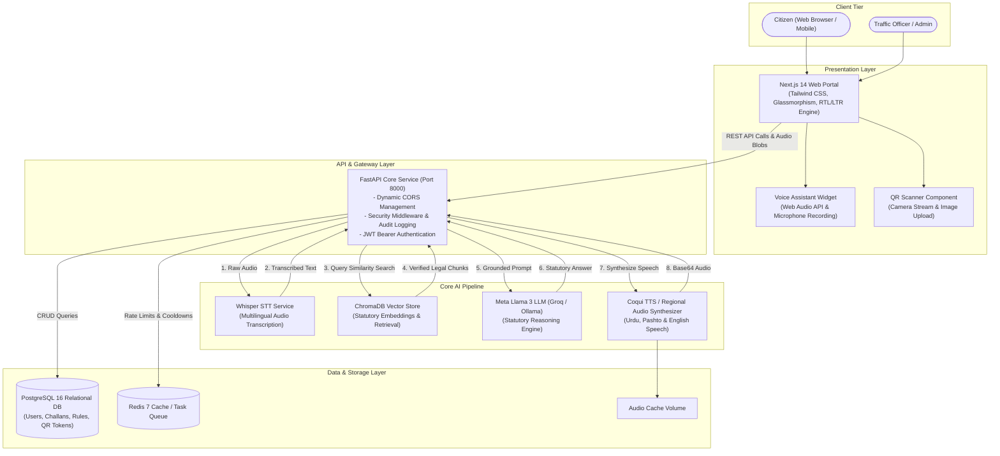
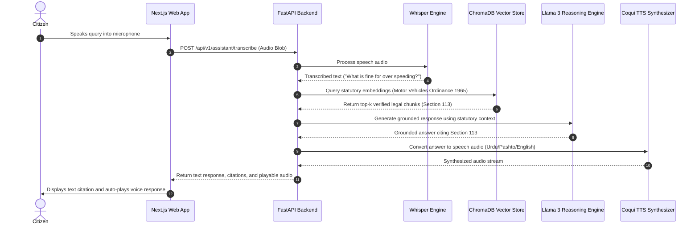

# System Architecture: AI Traffic Voice Assistant 🚦🏛️

## 1. High-Level Architecture Overview

The **AI Traffic Voice Assistant** is an intelligent multimodal civic platform designed to provide instant traffic e-challan inquiries, statutory violation explanations, and fine verification through conversational voice and text interactions in **Urdu, Pashto, and English**.

---

## 2. Multilingual Voice & RAG Processing Pipeline

---

## 3. Security Architecture & Anti-Hallucination Guarantees

1. **Grounded Legal Retrieval (No Hallucinations):**
   - The LLM is strictly instructed via system prompts not to act as a primary legal authority.
   - If retrieved context does not contain statutory backing or the query is out of scope (e.g. general knowledge), the system explicitly refuses rather than speculating.
2. **Cryptographic QR Validation:**
   - QR codes are bound 1-to-1 with specific citation records via HMAC-signed tokens (`QRC-...`).
   - Every scan is logged in the immutable audit trail, tracking client IP and incrementing scan counts.
3. **2FA SMS OTP Mobile Verification:**
   - Enforces a 60-second cooldown between requests and caps maximum requests at 5 per hour.
   - Verification attempts lock after 5 consecutive failures.
