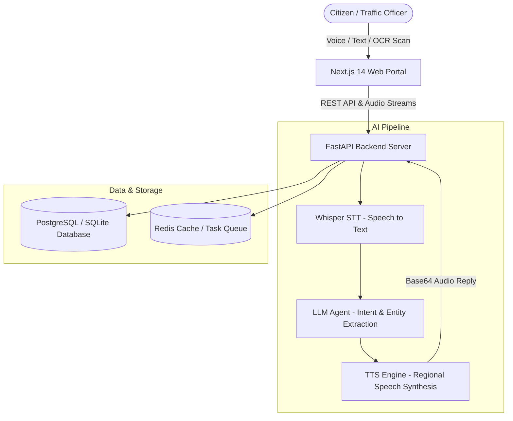

# System Architecture: AI Traffic Voice Assistant

## Overview
The AI Traffic Voice Assistant is an intelligent multimodal civic platform designed to simplify traffic challan discovery, violation explanations, and fine payments through conversational voice and text interactions in multiple regional languages.

## Architecture Diagram

## Key Modules
1. **Multilingual Voice Pipeline:**
   - **Whisper Speech-to-Text:** Converts microphone audio clips into structured text prompts.
   - **LLM Reasoning Engine:** Detects intent (`CHECK_CHALLAN`, `TRAFFIC_RULE_QUERY`, `PAYMENT_HELP`), extracts license numbers, and queries the database.
   - **TTS Audio Synthesizer:** Converts text responses into natural regional speech (Hindi, Marathi, English, etc.).
2. **Citizen Portal:**
   - OTP-based login, vehicle registration tracking, real-time challan search, fine settlement.
3. **Admin Portal:**
   - Real-time violation statistics, rule fine overrides, citizen inquiry logs.
