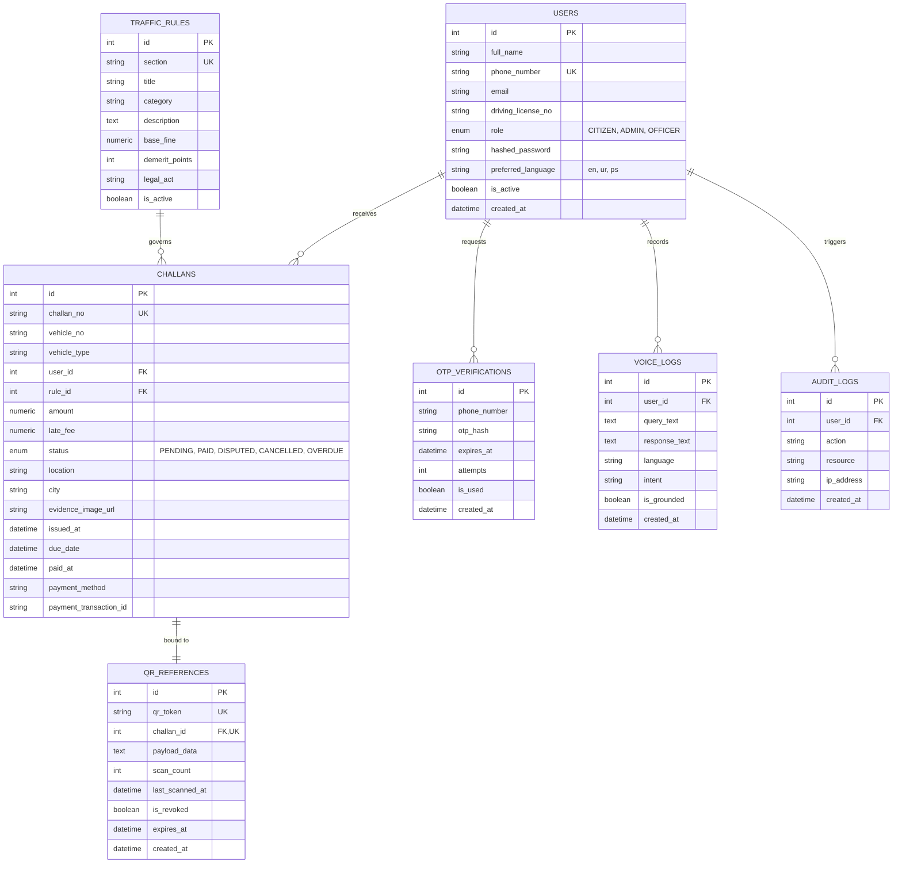

# Database Schema Specification 🗄️

The database is built on PostgreSQL 16 (with SQLite support for local rapid testing) managed via SQLAlchemy 2.0 ORM and Alembic migrations.

---

## Entity-Relationship Diagram

